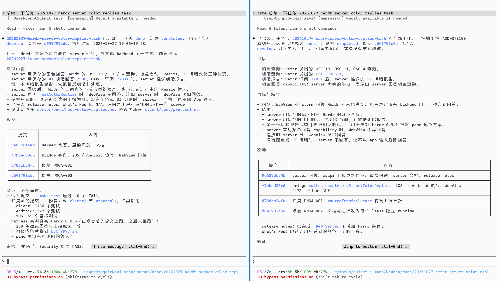

经常使用 AI 的朋友都会发现，AI 在汇报时，输出不但有各种黑话，而且存在格式随意、难以理解等问题。

对于黑话，我觉得和 AI 大量学习英文技术文档，以及中文技术资料中普遍存在的翻译腔有关系。例如“根因”是 “Root Cause”的直译，这个词在英文技术领域其实属于标准用语，只是这种直译不如“问题的原因”更容易阅读。

而格式随意则是另一个问题。AI 并不会天然按照固定格式输出，同一个模型在不同上下文、模型设置下，也可能用不同的方式汇报相同的任务。

再加上有些模型或 skill 会特别强调输出简洁，结果就是输出的字数少了，信息密度更大了，读起来更费脑子。

对于这个问题，我曾经搞过一些汇报模板，实践下来效果也不错，就是不同项目间缺乏通用性。

~

## 解法

直到有次我在 X 上看到 [K 神的一个帖子](https://x.com/karpathy/status/2105819303471976479) 。他说让 AI 按照 ASD-STE100 的规范来解释某件事，经常会更容易阅读。

> ASD-STE100（Simplified Technical English，简化技术英语）的核心思想：限制语言的表达方式，减少歧义，让技术信息更容易被准确理解。
>
> 它最初用于航空维修文档，目的是避免工作人员因误解说明而发生操作错误。现行第 9 版（2025 年）包含 53 条写作规则和一套受控词典。

我立马想到，既然英文可以这样做，中文也完全可以。

当然，直接套用到中文肯定不行，毕竟语言的表达方式和能力有很大差异。所以我借鉴其思路做了一个叫做 https://github.com/dualface/ste-zh 的 skill。

总结为一句话就是：回复清晰易读，不说鬼话。

下面有一张对比图，同样的模型，都是全新会话，要求对同一个任务进行总结。

右侧是使用 ste-zh skill 的效果，可以明显看到不管是遣词造句还是排版，都更容易阅读。



ste-zh 的目标不是让模型输出更少的内容，而是约束模型可以使用的状态词、情态词，以及一些关键术语，并且指定了明确的汇报结构。

另外就是 ste-zh 会明确写清楚任务完成状态和验证状态。比如代码改完了，不代表问题已经解决。AI 必须说明做了哪些检查，哪些结果还没验证，一行一条列出来。基本上一个任务做完还有没有残留问题点，一眼就能看明白。

我个人用了一段时间，感觉非常舒服，明显降低了心智负担。

~

## 安装和使用

说完了概念和介绍，下面讲一下具体的用法。

安装最简单的方式就是把下面的提示词发给 AI：

```text
安装 skill: https://github.com/dualface/ste-zh

并告诉我如何使用
```

如果希望为电脑上所有 Agent 一次性全安装，可以用：

```
npx skills add dualface/ste-zh --global --all
```

安装完成后，在需要 AI 做汇报时，用提示词：

```
/ste 总结 XXX 任务
```

如果是 codex，应该用：

```
$ste 总结 XXX 任务
```

> 注意 `ste-zh` 只是仓库名，skill 正式名字是 `ste`，所以需要用 `/ste` 或 `$ste` 来触发。
>
> 还有一个 https://github.com/dualface/ste-zht 是按照台湾的习惯来翻译的，大家可以按需取用。

~

## 拓展用法

当然了，这个 skill 也不是万灵药，不是所有的地方都适合。比如你在和 AI 讨论需求的过程里，其实就不太适合用这个 skill，因为需求里通常会有很多不确定，或者需要进一步核实的信息，这时候如果用这个 skill 反倒会影响 AI 自由探索和讨论问题。

但是在需求讨论完成，需要总结时，用这个 skill 就很合适了。总之大家可以多尝试，看看不同场景下的使用差异，找到最适合自己的用法。

~

## 感谢

目前这个 skill 在 GitHub 上涨星很快，完全超出我的预料，说明大家对理解 AI 任务汇报有明确的痛点。

我日常也会收集任务的原始信息和汇报结果，用于进一步微调这个 skill。

最后，如果大家觉得这个 skill 有用，欢迎在 github 里送上一颗小心心。

~

**作者的其他项目**

欢迎体验作者 dualface 的其他项目：

- [Kander](https://github.com/dualface/kander)：规则驱动的多 Agent 看板调度工具，内置独立审核与自动化交付门禁。
- [Ullage](https://github.com/dualface/ullage-cli)：本地守护进程与 CLI 工具，查看 Claude、ChatGPT、Grok、Cursor 等订阅的用量。
- [QuickTUI](https://quicktui.ai)，[QuickTUI 中文站](https://quicktui.cn)：适用于各类编码 Agent 的手机端完整终端，支持自托管直连，单台主机免费。
