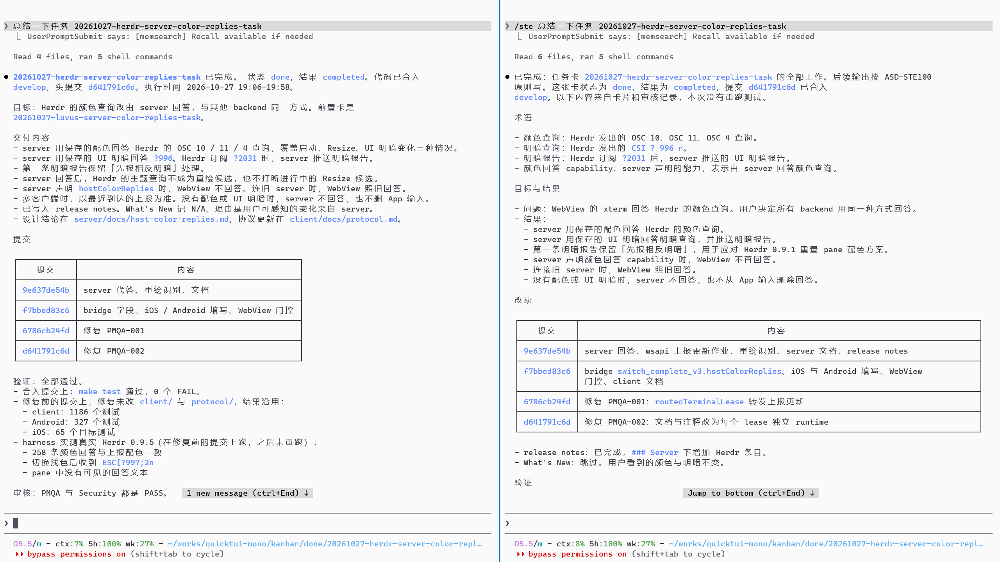

Anyone who uses AI regularly has seen this: when an AI reports on its work, the output is full of jargon, the format is arbitrary, and the result can be hard to understand.

I think the jargon has two sources: AI models learn heavily from English technical documents, and Chinese technical writing is itself full of stiff, translated phrasing. Take 根因, a word-for-word translation of "root cause". The term is standard in English technical writing, but in Chinese this literal version is harder to read than a plain phrase like 问题的原因 ("the cause of the problem").

Format is a separate problem. AI doesn't naturally stick to a fixed format. The same model can report on the same task in different ways, depending on the context or settings.

On top of that, some models and skills push hard for brevity. The output gets shorter, the information gets denser, and reading it takes more mental effort.

I once tried a few report templates for this. They worked well in practice, but they didn't carry over from one project to another.

~

## Borrowing from Simplified Technical English

Then I saw [a post by Andrej Karpathy](https://x.com/karpathy/status/2105819303471976479) on X. He said that asking AI to explain something according to the ASD-STE100 spec often makes the explanation easier to read.

> The core idea of ASD-STE100 (Simplified Technical English) is to limit how language is used. That reduces ambiguity and makes it easier for readers to understand technical information correctly.
>
> It began with aviation maintenance documents, where the goal was to prevent operating mistakes caused by misread instructions. The current Issue 9 (2025) has 53 writing rules and a controlled dictionary.

My first thought was that if English can do this, Chinese certainly can too.

Applying it directly to Chinese won't work, of course, because Chinese and English express things very differently. So I borrowed the idea and built a skill called [ste-zh](https://github.com/dualface/ste-zh) (in Chinese).

In one sentence: replies that are clear and easy to read, with no gibberish.

Below is a comparison. It uses the same model and a fresh session on each side, with both asked to summarize the same task.

The right side uses the ste-zh skill. Both the wording and the layout are clearly easier to read. The screenshots are in Chinese, but you can still compare the layouts.



The goal of ste-zh isn't to make the model say less. It limits the words the model can use to describe status and to express certainty or obligation, along with some key terms. It also sets a clear report structure.

ste-zh also makes the report state the task's completion status and verification status explicitly. For example, finished code changes don't mean the problem is solved. The AI has to say which checks it ran and which results are still unverified, one item per line. You can usually tell at a glance whether a finished task still has open issues.

I've been using it for a while and it feels great. It has clearly reduced my mental load.

~

## Install and use it

That covers the concept. Here's how to use it.

The easiest way to install it is to send this prompt to your AI:

```text
Install this skill: https://github.com/dualface/ste-zh

Then tell me how to use it
```

To install it for every agent on your machine at once, run:

```
npx skills add dualface/ste-zh --global --all
```

After that, when you need a report from the AI, use this prompt:

```
/ste Summarize the XXX task
```

In Codex, use this instead:

```
$ste Summarize the XXX task
```

> Note that `ste-zh` is only the repository name. The skill's actual name is `ste`, so you trigger it with `/ste` or `$ste`.
>
> There is also [ste-zht](https://github.com/dualface/ste-zht) (in Chinese), translated to match usage in Taiwan. Pick whichever suits you.

~

## Where it fits and where it doesn't

This skill isn't a cure-all, and it doesn't suit every situation. When you're discussing requirements with the AI, for example, it's usually a poor fit. Requirements tend to involve a lot of uncertainty and details that still need checking, and at that stage the skill will get in the way of the AI exploring and discussing the problem freely.

Once the discussion is done and you need a summary, the skill is a good fit. Try it in different situations, see how the results differ, and find the way of using it that works best for you.

~

## Thanks

The skill has been gaining GitHub stars quickly, far beyond what I expected. That tells me people clearly struggle to understand AI task reports.

I also collect raw task details and the resulting reports in my daily work, and I use them to adjust the skill further.

If you find this skill useful, I'd love a star on GitHub.

~

**Other projects by the author**

Try my other projects:

- [Kander](https://github.com/dualface/kander): a rule-driven kanban scheduling tool for multiple agents, with built-in independent review and automated delivery gates.
- [Ullage](https://github.com/dualface/ullage-cli): a local daemon and CLI tool for checking usage of subscriptions such as Claude, ChatGPT, Grok, and Cursor.
- [QuickTUI](https://quicktui.ai), [QuickTUI Chinese site](https://quicktui.cn) (in Chinese): a full mobile terminal for all kinds of coding agents, with self-hosted direct connections, free for a single host.

> This post was written in Chinese and translated into English with AI assistance.
